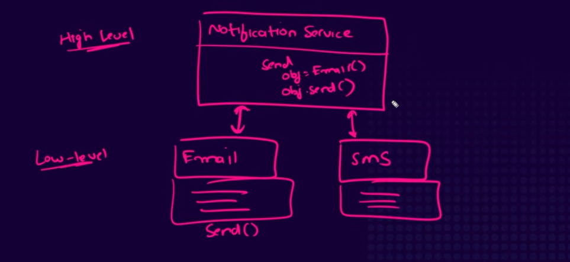
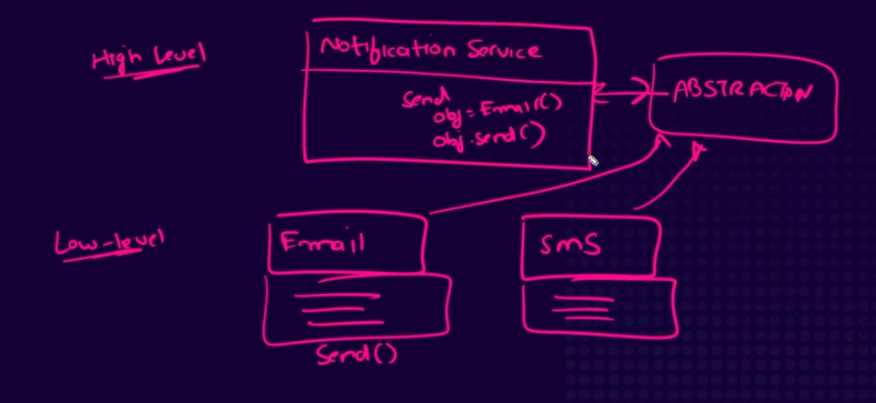

# SOLID Principles
SOLID is an acronym for the five principles which ensures that we follow best practices while writing code.

## What SOLID represents
1. Single Responsibility Principle
2. Open Close Principle
3. Liskov Substitution Principle
4. Interface Segregation Principle
5. Dependency Inversion Principle

## Explaination
Explaination of each principle with code example.

### 1. Single Responsibiliy Principle
* It says that the class or module which is associated with a certain functionality of the sotware should only be concerned with that specific functionality.
* In Other words, a class should have only one reason to change.

#### Example
##### Violation Example
This code violates Single Responsibility Principle
```python
class Employee:
    def __init__(self, name, salary):
        self.name = name
        self.salary = salary

    def calculate_yearly_salary(self):
        return self.salary * 12

    def save_to_database(self):
        print("Saving employee data to db")

    def generate_report(self):
        print("Generating employee report")
```
The employee class has three responsibilities in this case. (Calculate, Save to DB and Generate report)

##### Good Example
This code follows Single Responsibility Principle
```python
class Employee:
    def __init__(self, name, salary):
        self.name = name
        self.salary = salary

class SalaryCalculator:
    def calculate_yearly_salary(self, employee):
        return employee.salary * 12

class EmployeeDatabse:
    def save_to_database(self, employee):
        print("Saving employee data to db")

class EmployeeReport:
    def generate_report(self, employee):
        print("Generating employee report")
```

This code has divided responsibilities and each class has its own single responsibility.

#### Advantages of Single Responsibility Principle
1. Maintainability - Makes the code easier to maintain. Changing code of one functionality does not affect other functionality.
2. Code Reusability - Individual Classes can be resued in different parts of the application.
3. Easier to Test - Smaller classes with focused responsibilities are easier to test.
4. Readability - Code becomes clean, much easier to understand and read.
5. Loose Coupling - Classes become independent of each other.

### 2. Open Close Principle
* It says that the software entities like classes modules or functions should be open for extension and closed for modification.

#### Example

##### Violation Example
This code violates the Open Close Principle
```python
class Rectangle:
    def __init__(self, length, width):
        self.length = length
        self.width = width

class AreaCalculator:
    def calculate_area(self, rectangle):
        if isinstance(shape, Rectangle):
            return shape.height * shape.width

rectangle = Rectangle(5,10)
calculator = AreaCalculator()

print(calculator.calculate_area(rectangle))
```
In this code if we have to implement area of circle, we will have to modify the original AreaCalculator class code, which violated open close principle.

#### Good Example
This code follows Open Close Principle
```python
from abc import ABC, abstractmethod

class Shape(ABC):
    @abstractmethod
    def area(self):
        pass

class Rectangle(Shape):
    def __init__(self, width, height):
        self.width = width
        self.height = height

    def area(self):
        return self.width * self.height

class Circle(Shape):
    def __init(self, radius):
        self.radius = radius

    def area(self):
        return 3.14 * self.radius * self.radius

class AreaCalculator:
    def calculate_area(self, shape):
        return shape.area()
```
This example follows Open Close Principle. Here, the AreaCalculator code can accomodate even new shapes that are added without modifying the code.

#### Advantage of Open Close principle
1. Promotes flexibility - Changes or extensions can be made to the software behaviour without modifying the existing code.
2. Reduces risk of errors - Since the existing code is not modified, there is less chance of errors or breaking the code unintentionally.
3. Encourage modular architecture - It makes the code more readable and easier to understand and change because the classes are clearly defined and implemented leaving less room for ambiguity.

### 3. Liskov Substitution Principle
* It states that objects of parent class should be replacable with objects of a child class without breaking the program.
* An object of a child class should be usable wherever an object of its parent class is expected, without breaking the expected behaviour of the program.

#### Example

##### Violation Example
```python
class BankAccount:
    def __init__(self, balance):
        self.balance = balance

    def deposit(self, amount):
        pass

    def withdraw(self, amount):
        pass


class SavingsAccount(BankAccount):
    def __init__(self, balance):
        super().__init__(balance)

    def deposit(self, amount):
        self.balance += amount
        print(f"Amount Deposited: {amount}\nCurrent Balance: {self.balance}")

    def withdraw(self, amount):
        self.balance -= amount
        print(f"Amount Withdrew: {amount}\nCurrent Balance: {self.balance}")


class FixedDepositAccount(BankAccount):
    def __init__(self, balance):
        super().__init__(balance)

    def deposit(self, amount):
        self.balance += amount
        print(f"Amount Deposited: {amount}\nCurrent Balance: {self.balance}")

    def withdraw(self, amount):
        self.balance -= amount
        raise Exception("Can't withdraw from FD account.")


savings_account = SavingsAccount(200)
fd_account = FixedDepositAccount(250)


def withdraw_money(account, amount):
    return account.withdraw(amount)


withdraw_money(savings_account, 50)
withdraw_money(fd_account, 50)

```

This code will throw exception. It violates Liskov Substitution Problem, because the object of child class breaks the parent class (Because we can't withdraw from FD account)

##### Good Example
```python
class BankAccount:
    def __init__(self, balance):
        self.balance = balance

    def deposit(self, amount):
        pass


class WithdrawableAccount(BankAccount):
    def __init__(self, balance):
        super().__init__(balance)

    def withdraw(self, amount):
        pass


class SavingsAccount(WithdrawableAccount):
    def __init__(self, balance):
        super().__init__(balance)

    def deposit(self, amount):
        self.balance += amount
        print(f"Amount Deposited: {amount}")

    def withdraw(self, amount):
        self.balance -= amount
        print(f"Amount withdrew: {amount}")


class FixedDepositAccount(BankAccount):
    def __init__(self, balance):
        self.balance = balance

    def deposit(self, amount):
        self.balance += amount
        print(f"Amount Deposited: {amount}")


def withdraw_money(account: WithdrawableAccount, amount):
    account.withdraw(amount)


savings_account = SavingsAccount(200)
fd_account = FixedDepositAccount(250)

withdraw_money(savings_account, 50)
withdraw_money(fd_account, 50) # You can't do that because there is no function to withdraw for fd class as it is inherited directly from bank account class

```
In this example, the code is following Liskov Substitution Principle. Because Now the classes are clearly defined. The FD Account will just not have withdraw function. The Savings account will be a chiled of withdrawable account so it will have both withdraw and deposit functionality.

#### Advantages of Liskov Substitution Principle
1. Prevents Unexpected Errors - Ensures child classes honour the behaviour promised by their parent classes.
2. Better Maintainability - Changes to child classes are less likely to break parent classes.
3. Promotes better inheritance design - Encourages developers to create meaningful class hierarchies instead of forcing unrelated classes to inherit from each other.

### 4. Interface Segregation Principle
* It says the the classes should not be forced to implement methods that they don't need.
* Break large, general purpose interfaces into smaller, more specific ones.

#### Example

##### Violation Example
```python
from abc import ABC, abstractmethod


class Employee(ABC):
    @abstractmethod
    def eat(self):
        pass

    @abstractmethod
    def work(self):
        pass


class Human(Employee):
    def eat(self):
        print("Human employee is eating")

    def work(self):
        print("Human employee is working")


class AIAgent(Employee):
    def work(self):
        print("AI Agent employee is working")

    def eat(self):
        raise Exception("AI Agent can't eat.")

```
In this example, the code is violating Interface Segregation Principle.
Why? Because the AIAgent class has to implement an abstract method eat() but it is unncessary.

##### Good Example
```python
from abc import ABC, abstractmethod


class Eatable(ABC):
    @abstractmethod
    def eat(self):
        pass


class Workable(ABC):
    @abstractmethod
    def work(self):
        pass


class Human(Eatable, Workable):
    def eat(self):
        print("Human employee is eating")

    def work(self):
        print("Human employee is working")


class AIAgent(Workable):
    def work(self):
        print("AI Agent employee is working")

```
Here, The code is following Interface Segregation Principle. Why? Because here, the AIAgent class is only inheriting from interfaces it needs and there is no unnecessary implementation of eat() method

#### Advantages of Interface Segregation Principle
1. Modular code - Code only uses what it actually needs
2. Testability - Code is easier to test
3. Maintainability - Code is easier to maintain and makes more sense.

### 5. Dependency Inversion Principle
* It says that high level modules should not depend directly on low level modules.
* Both should depend on abstrations (interfaces)

#### Example

##### Violation Example

```python
class EmailService:
    def send_email(self, message):
        print(f"Sending e-mail: {message}")


class SMSService:
    def send_sms(self, message):
        print(f"Sending SMS: {message}")


class NotificationService:
    def __init__(self):
        self.email_service = EmailService()
        self.sms_service = SMSService()

    def notify_by_email(self, message):
        self.email_service.send_email(message)

    def notify_by_sms(self, message):
        self.sms_service.send_sms(message)


notification_service = NotificationService()
notification_service.notify_by_email("Good Morning")
notification_service.notify_by_sms("Hey")

```
This code violates Dependency Inversion Principle. Why? Because here, the notification service (high level) is directly dependent on email service and sms service (low level). This creates complications when you want to add new service. Let's suppose we want to add whatsapp service, then we will have to change the code of the high level service (NotificationService)

##### Good Example

```python
from abc import ABC, abstractmethod


# Abstraction (Interface)
class NotificationChannel(ABC):
    @abstractmethod
    def send(self, message):
        pass


# Low Level Services
class EmailService(NotificationChannel):
    def send(self, message):
        print(f"Sending e-mail: {message}")


class SMSService(NotificationChannel):
    def send(self, message):
        print(f"Sending SMS: {message}")


# High Level Service
class NotificationService:
    def __init__(self, channel: NotificationChannel):
        self.channel = channel

    def notify(self, message):
        self.channel.send(message)


sms_service = SMSService()

notification_service = NotificationService(sms_service)

notification_service.notify("Good Morning")

```
This code is Dependency Inversion Principle compliant. Why? Because here, the notification service (high level) is talking to the abstraction NotificationChannel (Interface) and not directly to EmailService and SMSService (low level). If we want to add a new service (say, whatsapp), we will just have to create its class which inherits from NotificationChannel. So there will be loose coupling and existing code won't be changed.

#### Advantages of Dependency Inversion Principle
1. Losse Coupling - High Level Classes don't depend directly on low level classes.
2. Easier to Extend - You can introduce new implementations without modifying existing high level classes.


## References
* [Dependency Inversion Principle Explained with Real Examples in Python - Code and Debug](https://www.youtube.com/watch?v=2QTaDaeTuls)
* [SOLID Principles Python - Real Python](https://realpython.com/solid-principles-python/)
