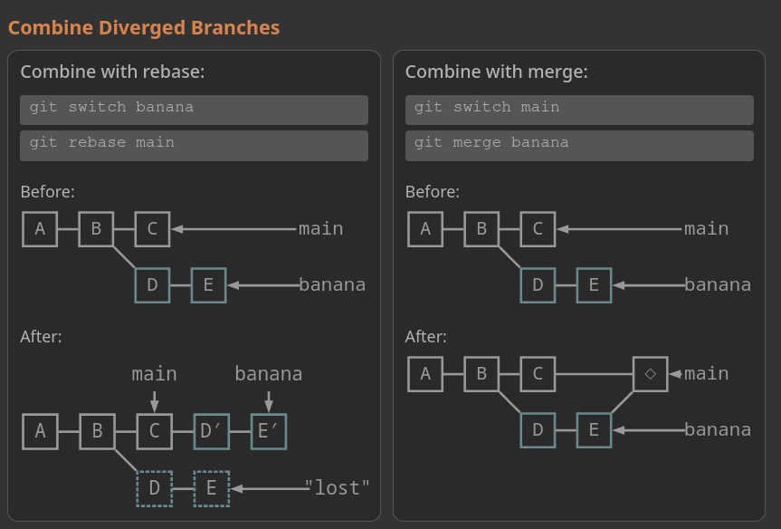
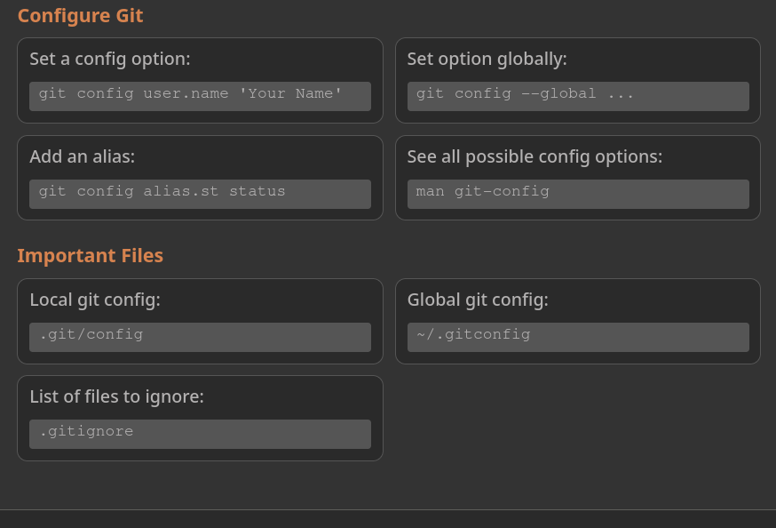

# Git Cheatsheet

## Easy
- git init (initialized default name master branch)
- git clone [URL]

## Commit Related
- git add [FILE]
- git add .
- git rm [FILE] (to remove a file)
- git restore --staged [FILE] to restore to staged
- git restore [FILE] to restore fully
- git reset HEAD~1 to go back one commit
- git rm --cached c.txt
- git commit -m "message"
- git commit -am "message"

## Branch Related
1. Create Branch: git switch -c [NEW_BRANCH]
2. Switch Branch: git switch [BRANCH]
3. List branches: git branch
4. Delete branch: git branch -d [BRANCH_NAME]
5. Force delete: git branch -D [BRANCH_NAME]
6. Very IMPORTANT AND CONFUSING (Just better to see it as image)

7. Rename current Branch: git branch -M [NEW_NAME]
8. Restore old file: git restore [FILE] --source [COMMIT]

## Remote Related
Firstly, REMOTE IS JUST WHAT YOU CALL THE REMOTE VERSION OF YOUR REPO.

### Adding remote / pushing remote
1. Add a Remote: git remote add [NAME(usually origin)] [URL] (Example: git remote add origin git@github.com:szzd7223/crypto-trading-app.git)
2. Push the main branch to the remote: git push origin main
3. Push the branch that you have never pushed before: git push -u origin [BRANCH_NAME]

### Pulling remote
1. Fetch changes (but don't change any of your local branches): git fetch origin main
2. Fetch and rebase: git pull --rebase
3. Pull: git pull

## Might be useful

